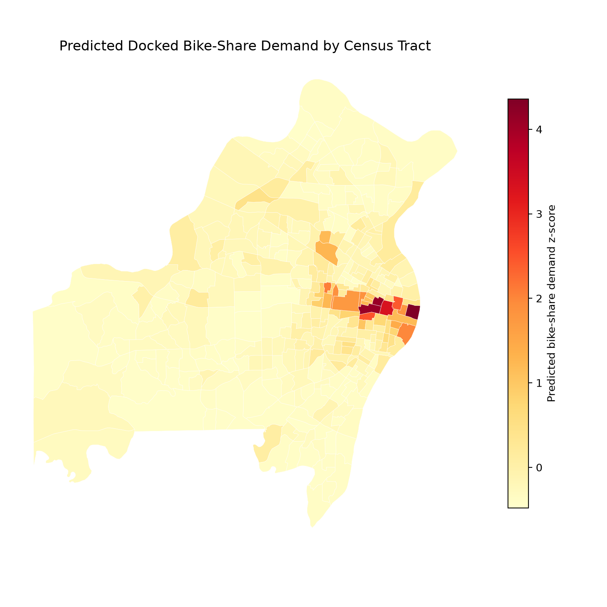
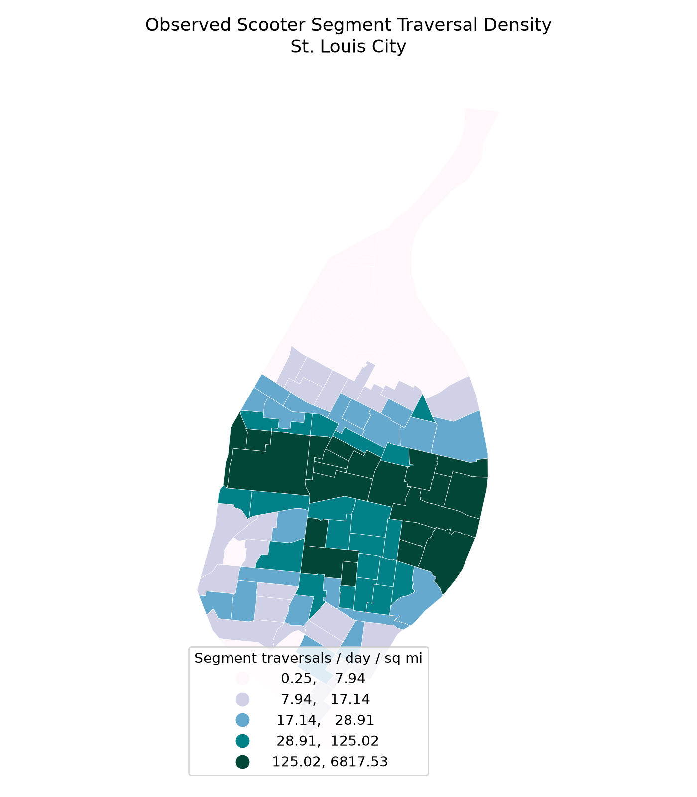
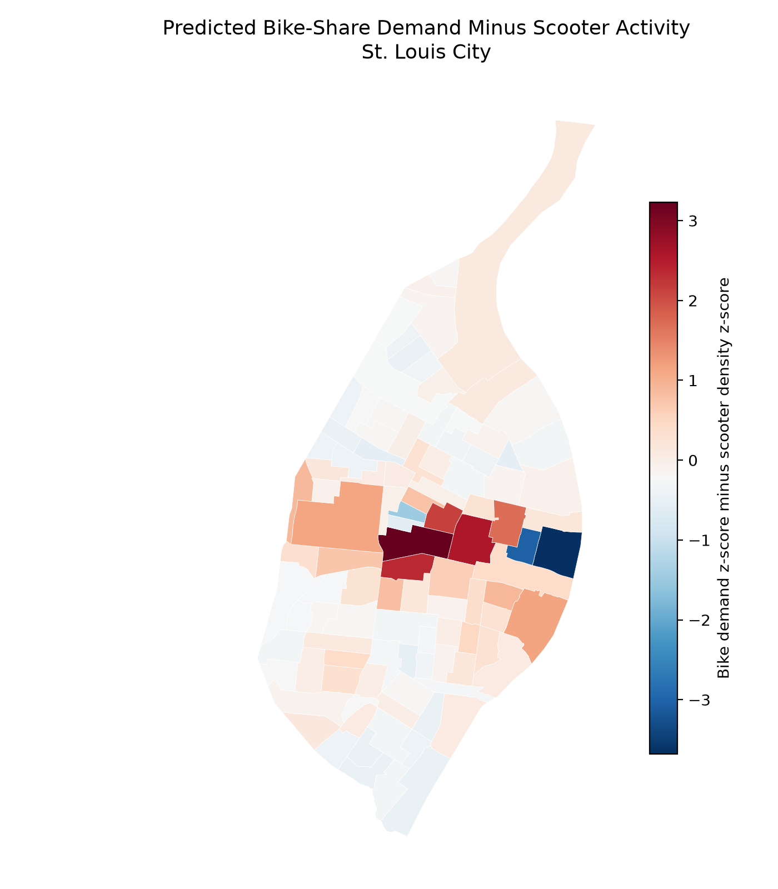

# St. Louis Bike-Share Demand Modeling

This repository prepares a research project on latent docked bike-share demand in St. Louis for public review. The analysis combines bike-share ridership from comparison cities, Census/ACS tract attributes, geospatial processing, and ensemble regression models to estimate where bike-share demand may exist in St. Louis even without a current docked system.

The project is titled **Modeling Latent Demand for Bike Share in St. Louis: A Comparative Analysis of Predictive Estimates and Scooter Deployment**.

## Project Overview

Transportation planners often need to estimate demand before a service exists. This project approaches that problem by learning from U.S. cities with operating bike-share systems, predicting tract-level St. Louis bike-share demand, and comparing those predictions with observed dockless scooter segment traversals.

The key planning question is: **where does the model predict high bike-share demand that is not matched by current scooter activity?** Those areas may merit closer review for future station placement, equity analysis, or field validation.

## Key Findings

- The demand model identifies high-predicted-demand tracts concentrated in St. Louis City and selected inner-ring county areas.
- Scooter activity is spatially concentrated in a smaller set of city tracts. The notebook comparison reports a Pearson correlation of **0.682** between predicted bike-share z-scores and scooter traversal z-scores.
- The largest positive bike-minus-scooter gaps in the checked notebook include tracts such as `29510112400`, `29510118600`, and `29510114300`. These should be treated as leads, not final station recommendations.
- Scooter values are **segment traversal counts**, not counts of unique scooter trips.

## Methods

The working project assembled station-level bike-share ridership, Census/ACS demographic variables, and census tract geometries across 11 U.S. bike-share markets. The modeling workflow included:

- Station and trip aggregation to census tracts using GeoPandas and tract geometries.
- Feature engineering from Census/ACS tables, including per-capita, land-area-normalized, and spatial-lag predictors.
- Feature screening using cross-city correlation behavior and regularized models.
- A stacked ensemble family using Elastic Net, Ridge Regression, Histogram-based Gradient Boosting, and Partial Least Squares components.
- Nested leave-one-city-out validation to test generalization to unseen bike-share markets.

The strongest verified model result in the accessible notebooks is from `notebooks/nested_loco_modeling_2010.ipynb`: **nested leave-one-city-out R² = 0.3605 ± 0.1128**. 

## GIS Workflow

The geospatial workflow has two major pieces:

- **Bike-share aggregation:** station coordinates and trip endpoints were associated with census tracts, then tract-level ridership rates were joined to Census/ACS predictors.
- **Scooter comparison:** St. Louis scooter street segments were intersected with census tract polygons. Each segment traversal count was allocated to tracts in proportion to the length of the segment inside each tract.

The reusable implementation of the second step is in `src/st_louis_bikeshare/geospatial.py`, with focused tests in `tests/test_geospatial.py`.

## Results

The St. Louis prediction files include 340 tracts across St. Louis City and St. Louis County. The scooter comparison notebook focuses on the 104 St. Louis City tracts with scooter segment intersections.

The generated figures below avoid third-party basemap tiles so they can be shared more cleanly.

### Predicted Bike-Share Demand



### Observed Scooter Segment Traversal Density



### Bike-Share Demand Minus Scooter Activity



## Repository Structure

```text
.
├── data/
│   ├── derived/        # small derived outputs used for documentation
│   └── sample/         # synthetic demo GeoJSON files
├── docs/               # source inventory and verification notes
├── figures/            # generated portfolio figures
├── notebooks/          # selected notebooks with outputs stripped
├── reports/            # report placeholder; PDF not included
├── scripts/            # lightweight demo scripts
├── src/                # reusable Python helpers
└── tests/              # geospatial unit tests
```

## Installation and Reproduction

Create an environment and install the package in editable mode:

```bash
python3 -m venv .venv
source .venv/bin/activate
pip install -e ".[dev]"
```

Run the lightweight geospatial tests:

```bash
pytest
```

Run the synthetic segment-allocation demo:

```bash
python scripts/run_segment_allocation_demo.py
```

The full modeling notebooks require large external datasets that are not committed here. Download the raw trip, ACS/Census, and tract geometry inputs separately, then adapt the notebook paths or place files under `data/raw/`.

## Data Sources and Limitations

Primary source data should be credited to the relevant bike-share system operators, the U.S. Census Bureau, St. Louis open/geospatial data sources, and the scooter-route data provider. Raw data redistribution rights were not fully verified, so this repository excludes large raw datasets and includes only small derived outputs and synthetic demonstration fixtures.

Known limitations:

- The reported R² is documented as a cross-city validation result from notebook source comments, not as a training score.
- Full reproduction requires external datasets and substantial compute.
- Scooter segment traversal counts are not unique trip counts and should not be interpreted that way.
